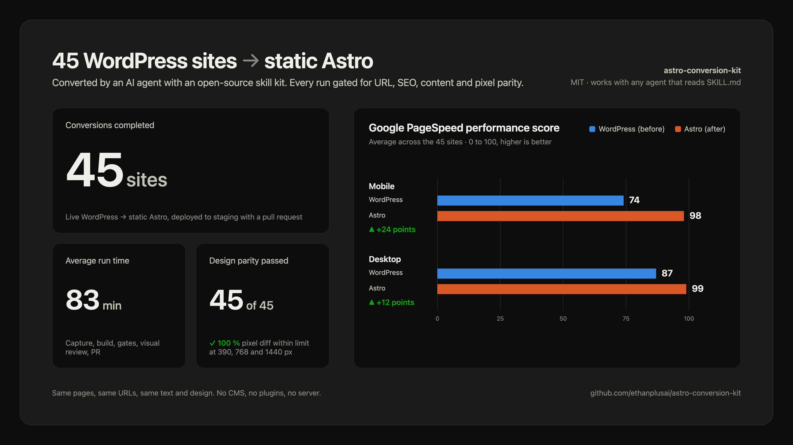
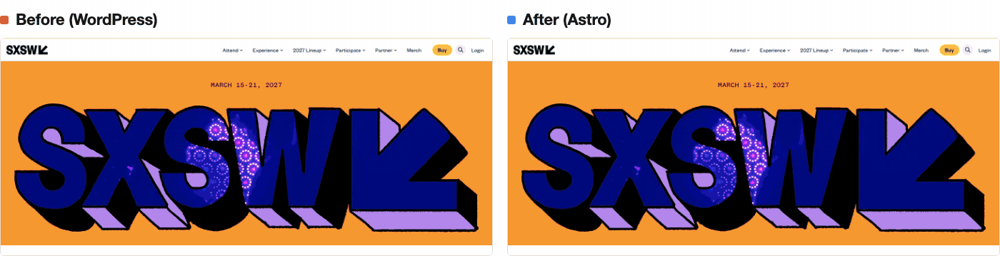
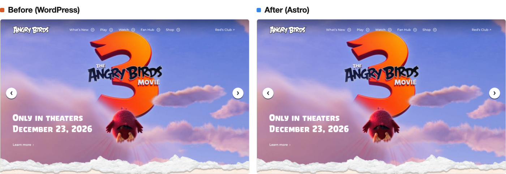

# Examples

## Results so far

Averages over 45 WordPress conversions run with this kit, each end to end by a coding agent
following `convert-site`:

| | |
|---|---|
| Conversions completed | 45 |
| Average run time | 83 minutes, intake to pull request |
| Design parity | 45 of 45 passed the pixel diff at 390, 768 and 1440 px |
| Google PageSpeed performance, mobile | 74 on WordPress, 98 on Astro (average) |
| Google PageSpeed performance, desktop | 87 on WordPress, 99 on Astro (average) |

## Public demo sites

WordPress sites converted by a coding agent following the skills as published, shown as the
runs left them. Each has a public Astro build on Vercel (a noindexed staging deploy). The images
put the live WordPress page beside the Astro build at 1440 px.

The numbers below are read from each converted repository: `.conversion/state.json` for the
phase results and timings, `baseline/` for the counts. Agent time is the time the agent spent
working, intake to pull request; the sxsw.com and harvard.edu runs also sat idle for a while on
an API rate limit, and that pause is not counted.

### sxsw.com

WordPress on WordPress VIP, block theme with the Interactivity API, Osano consent manager.

| | |
|---|---|
| Astro build | https://sxsw-com-astro-v2.vercel.app |
| Pages | 71 (82 captured URLs; 11 answer 404 on live and are reproduced) |
| Redirects | 83 |
| Media | 916 files, 2.0 GB |
| Templates | 26 |
| Agent time | 1 h 35 min |

The home page hero at 1440 px, recorded frame by frame on both sites with the hero video at the
same timestamps.

### harvard.edu

WordPress multisite, classic theme. The run converted the main site and left the sub-sites that
run as their own installs (`/president/`, `/media-relations/`) out by prefix.

| | |
|---|---|
| Astro build | https://harvard-edu-astro.vercel.app |
| Pages | 457 (461 captured URLs; 4 answer 404 on live and are reproduced) |
| Redirects | 417 |
| Media | 2,537 files, 563 MB |
| Templates | 30 |
| Agent time | 4 h 01 min |

`/ai/` at 1440 px, the screenshots the visual review took during the run.

### angrybirds.com

WordPress on WP Engine behind Cloudflare, converted in a separate run with the media library
(15,715 files) stored in Vercel Blob at the original paths.

| | |
|---|---|
| Astro build | https://angrybirds-com.vercel.app |
| Pages | 388 |
| Redirects | 2 |
| Media | 15,715 files in Vercel Blob, 102 theme and plugin files in the repo |
| Templates | 23 clusters, built as 8 layouts |

The home page at 1440 px, live beside a local build of the converted repository.

## What a demo is not

A demo is a staging deploy of the converted site, noindexed, with forms pointed at a placeholder
endpoint and nothing launched. The demo sites are not affiliated with the organisations whose
public pages they reproduce, and they exist to show what the kit produces from a live site, not
to serve those sites' visitors.
