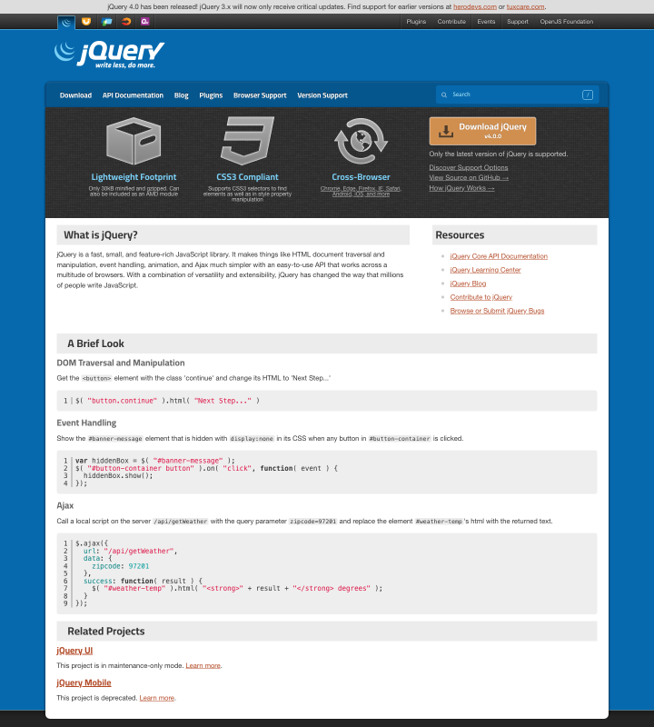

# Examples

Real conversions run with this kit, end to end, by a coding agent following `convert-site`. Each
section gives the numbers the run recorded (from the converted repository's `baseline/`,
`review/` and `.conversion/state.json`) and the home page before and after.

The screenshots are the run's own visual-review shots, cropped to the first 1600 CSS pixels of the
page and shown at half size. Before is the live site, after is the built Astro site; each pair has
the same crop and scale.

## jquery.com

| | |
|---|---|
| Site | https://jquery.com |
| Platform | WordPress |
| Pages | 13 (3 templates) |
| Media | 26 files, 461 KB, kept in the repository |
| Redirects | 4 |
| Worst pixel diff | 0.000 % (9 template pairs at 390, 768 and 1440; 26 page pairs at 390 and 1440) |
| Computed styles | 1470 of 1470 rows match |
| Gates | 10 of 10 pass, on the staging build and on the release build |
| Run time | about 33 minutes, intake to pull request |
| Suggestions | 149 (SEO 5, Links 100, Performance 19, Design 25) |
| Preview | https://jquery-com-astro-v2.vercel.app (noindexed) |

The converted site is a private repository; the preview is public.

### Home page at 390 px

| Before (live) | After (Astro) |
|---|---|
|  |  |

### Home page at 1440 px

| Before (live) | After (Astro) |
|---|---|
|  |  |

### What the kit reported as not covered

These went into the pull request as open items, not passes:

- **No sitemap on live.** The live robots.txt names `/wp-sitemap.xml`, which the capture never
  got, so pre-launch could not check old URLs beyond the 13 that the crawl and the REST API found.
  The fix is a URL list from the old host, which only the owner can publish.
- **404 share image.** pre-launch wants an `og:image` on the 404 page. The live site has none
  anywhere, and inventing a 1200x630 image is not parity, so the check stays failing until a
  person supplies one.
- **Dynamic search.** The search box is reproduced as markup and its third-party dropdown may
  keep working, but the full results page (`/?s=`) needs a server and stops working on the static copy.
